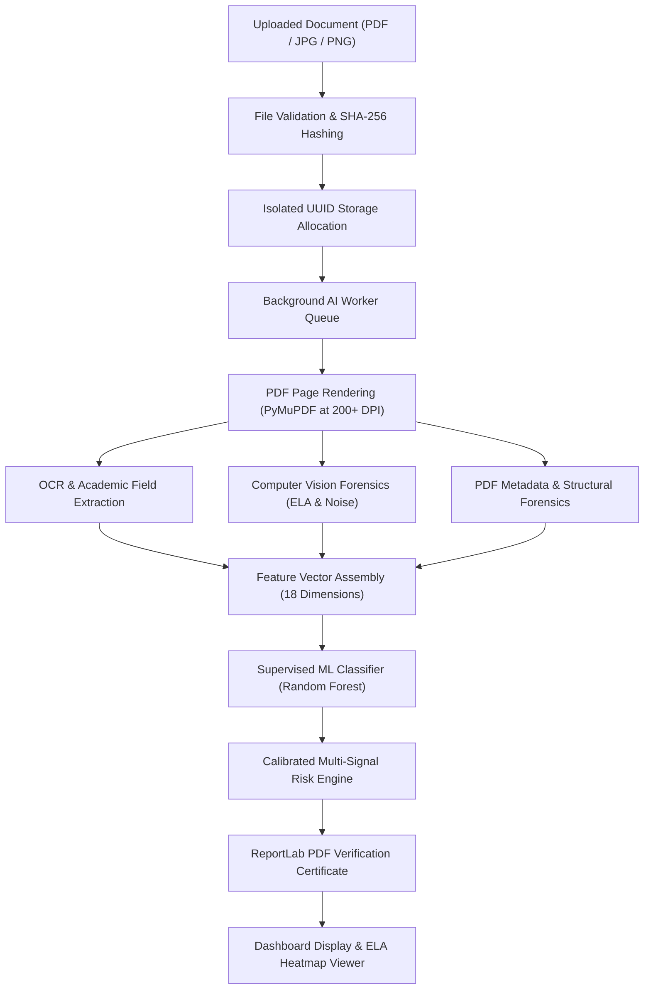

# DocShield AI — AI-Based Document Fraud Detection and Verification System

<div align="center">


[](https://python.org)
[](https://fastapi.tiangolo.com)
[](https://nextjs.org)
[](https://www.typescriptlang.org)
[](https://tailwindcss.com)
[](https://docker.com)
[](docs/testing.md)

**A final-year B.Tech Major Project in Computer Science (Session 2026–27)**  
*AI-assisted web platform for academic credential integrity analysis, digital image forensics, suspicious-region localization, risk assessment, and verification reporting.*

</div>

---

## 1. Project Team & Roles

| Team Member | Primary Role | Core Responsibilities |
| :--- | :--- | :--- |
| **Vaibhav** | **AI/ML & Backend Lead** | OCR & PDF rendering pipeline, computer vision forensics (ELA & noise analysis), dataset preparation, ML classifier training & evaluation, risk engine, FastAPI core services. |
| **Saurabh** | **Full-Stack & Deployment Lead** | Next.js App Router web application, dashboard & ELA visualizer, database schema & JWT authentication, Docker orchestration, CI/CD pipeline, testing & deployment support. |

---

## 2. Core Vision & Key Architectural Principles

Organizations such as universities, employers, credential verification agencies, and background verification providers process millions of digital academic records annually. Manual screening is slow, error-prone, and inconsistent.

**DocShield AI** integrates multiple deterministic and probabilistic forensics techniques into a unified, explainable decision pipeline:
1. **Document Integrity Analysis:** Detects spatial compression disparities (Error Level Analysis), texture inconsistencies (Laplacian variance), baseline slope distortions, and PDF metadata anomalies.
2. **AI/ML Supervised Assessment:** Evaluates multi-signal feature vectors using an actually trained and validated Random Forest classifier.
3. **Issuer Verification:** Optional connector for official sources (e.g. DigiLocker / National Academic Depository), truthfully reported as unavailable when official credentials are not configured.
4. **Human Review Support:** Summarizes findings, visualizes anomaly regions, and provides clear recommendations to human reviewers.

> **Non-Negotiable Truthfulness Guarantee:** DocShield AI never fabricates model predictions, training metrics, external verification responses, or deployment statuses.

---

## 3. Technology Stack

- **Frontend:** Next.js 14+ (App Router), TypeScript, Tailwind CSS, Lucide React Icons.
- **Backend API:** Python 3.11+, FastAPI, Pydantic v2, SQLAlchemy 2.0.
- **Database:** PostgreSQL (production) / SQLite (zero-config local dev).
- **Computer Vision & Forensics:** OpenCV (`opencv-python-headless`), Pillow (`PIL`), PyMuPDF (`fitz`).
- **Machine Learning:** Scikit-learn (Random Forest, Gradient Boosting), NumPy, Pandas.
- **Reporting:** ReportLab (multi-page PDF integrity report generator).
- **Background Workers:** Redis + Celery (distributed queue) with an integrated asynchronous thread pool fallback for instant local execution.
- **Testing & DevOps:** Pytest, HTTPX, Docker, Docker Compose, GitHub Actions.

---

## 4. End-to-End Processing Workflow



---

## 5. Features Actually Implemented

- [x] **Secure Upload & Storage:** MIME verification, binary magic byte signature checking, 15 MB size limits, SHA-256 integrity digest, and path traversal protection.
- [x] **Authentication & Ownership Isolation:** Salt-hashed bcrypt passwords, JWT Bearer tokens, and strict resource ownership checks (`current_user.id`).
- [x] **OCR & Academic Field Extraction:** Identifies student name, university/institution, degree, roll number, certificate number, date, and grade/CGPA with coordinates.
- [x] **Error Level Analysis (ELA):** Computes pixel-wise difference maps at 92% JPEG resave quality, highlighting compression anomalies and generating visual heatmaps.
- [x] **Noise & Texture Consistency:** Evaluates 16x16 grid patches using high-frequency Laplacian variance to detect spliced copy-paste patches.
- [x] **Layout & Typography Analysis:** Measures bounding box line slope variance and character height distributions.
- [x] **Supervised ML Pipeline:** 18-dimensional feature vector, synthetic dataset generator with grouped document splitting (`GroupShuffleSplit`) to prevent data leakage, model training, evaluation, and serialized artifacts (`docshield_classifier_v1.joblib`).
- [x] **Truthful ML Degradation:** Gracefully reports `"Model not trained / unavailable"` if model artifacts are removed, continuing forensic processing without crashing.
- [x] **Explainable Risk Engine:** Calibrated scoring (0-100) into 4 risk tiers (`LOW_RISK`, `MEDIUM_RISK`, `HIGH_RISK`, `INCONCLUSIVE`) with itemized evidence impact points.
- [x] **Official PDF Verification Report:** Generates formal downloadable PDF audit certificates containing document checksums, findings tables, and review recommendations.
- [x] **Next.js Web Interface:** Modern, high-contrast dashboard with database-backed statistics, drag-and-drop upload, interactive document detail views with ELA viewer, audit history, and settings.
- [x] **100% Passing Automated Tests:** 10/10 automated Pytest test cases covering units, security, auth, forensics, ML, and end-to-end integration.

---

## 6. Quickstart Guide (Local Development)

### Prerequisites:
- Python 3.11+
- Node.js 18+ and npm

### 1. Clone & Setup Backend
```bash
# In the project root
python -m pip install -r backend/requirements.txt
python -m pip install pytest httpx email-validator

# Train the baseline ML model (generates dataset & serialized artifact)
python -m ai.training.train

# Start FastAPI Backend Server
uvicorn backend.app.main:app --host 127.0.0.1 --port 8000 --reload
```
*Backend API will be running at:* `http://127.0.0.1:8000` (Swagger UI at `/docs`)

### 2. Setup & Run Frontend
```bash
# In another terminal window
cd frontend
npm install
npm run dev
```
*Frontend will be running at:* `http://localhost:3000`

### 3. Demo Credentials
DocShield AI comes pre-seeded with a demo reviewer account:
- **Email:** `demo@docshield.ai`
- **Password:** `DemoPass123!`

---

## 7. Multi-Container Docker Deployment

To launch the complete isolated production environment with PostgreSQL, Redis, Celery, FastAPI, and Next.js:

```bash
# Build and launch all services
docker-compose up --build -d
```

| Service | Container Name | Port | Description |
| :--- | :--- | :--- | :--- |
| **Frontend** | `docshield-frontend` | 3000 | Next.js App Router Web UI |
| **Backend** | `docshield-backend` | 8000 | FastAPI REST API Gateway |
| **Worker** | `docshield-celery-worker` | — | Celery distributed AI worker |
| **Database** | `docshield-postgres` | 5432 | PostgreSQL 15 database |
| **Redis** | `docshield-redis` | 6379 | Celery message broker |

---

## 8. Automated Test Execution

Run the comprehensive automated test suite:
```bash
python -m pytest backend/tests/test_api.py -v
```

All 10 test cases run against a live database session and real document fixtures, validating operational probes, file validation, academic field extraction, ELA forensics, ML predictions, cross-user security isolation, and ReportLab PDF report generation.

---

## 9. Project Structure

```
Detection_System/
├── backend/
│   ├── app/
│   │   ├── api/v1/endpoints/  # auth, documents, verifications, dashboard
│   │   ├── core/              # pydantic configuration & settings
│   │   ├── db/                # session, init_db, database connection
│   │   ├── models/            # SQLAlchemy database entities
│   │   ├── schemas/           # Pydantic v2 request/response schemas
│   │   ├── security/          # password hashing (bcrypt), JWT tokens
│   │   ├── services/          # verification pipeline, file validation
│   │   ├── storage/           # local & S3 storage adapters
│   │   ├── workers/           # Celery worker & inline thread dispatcher
│   │   └── main.py            # FastAPI entrypoint
│   ├── tests/                 # Comprehensive Pytest test suite
│   ├── requirements.txt       # Python dependencies
│   └── Dockerfile             # Backend container image
├── frontend/
│   ├── src/
│   │   ├── app/               # Next.js App Router pages (/, /dashboard, /upload, /documents/[id], etc.)
│   │   ├── components/        # Navbar, Footer, RiskBadge, StatCard
│   │   ├── lib/               # api.ts client library
│   │   └── types/             # TypeScript interfaces
│   ├── package.json           # Node.js dependencies
│   └── Dockerfile             # Frontend container image
├── ai/
│   ├── ocr/                   # PyMuPDF vector OCR & contour text engine
│   ├── preprocessing/         # PDF converter & image normalization
│   ├── field_extraction/      # Academic regex & layout parser
│   ├── forensics/             # Error Level Analysis (ELA) & noise inconsistency
│   ├── features/              # Standardized 18-dim feature schema
│   ├── training/              # GroupShuffleSplit dataset generator & model training
│   ├── inference/             # Model loading & graceful degradation service
│   └── artifacts/             # Serialized model (.joblib) & metadata (.json)
├── reports/
│   └── generator.py           # ReportLab PDF report generator
├── docs/                      # Architecture, API, Model Card, Security, Deployment, Testing
├── docker-compose.yml         # 5-service container orchestration
├── .env.example               # Environment template
└── README.md                  # Project documentation
```

---

## 10. Academic Disclaimer & Limitations

DocShield AI is an automated screening assistant designed to triage suspicious academic credentials for human review. It does not constitute legal proof of authenticity or fraud. Real-world physical verification or official government issuer APIs (e.g., DigiLocker / NAD) remain the authoritative source of verification.
