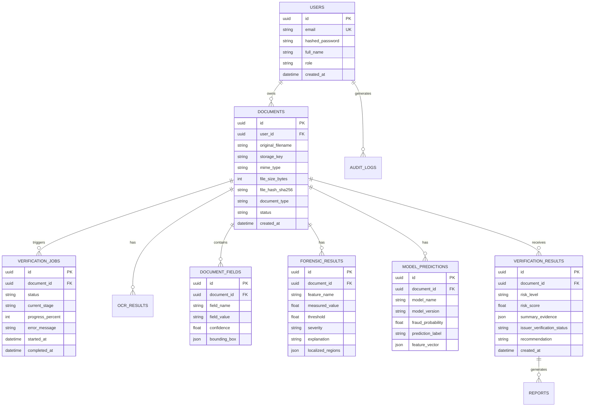

# DocShield AI — System Architecture Specification

## 1. System Overview
DocShield AI is an end-to-end web platform designed to analyze digital academic documents (degrees, diplomas, mark sheets) for potential signs of forgery, tampering, and unauthorized manipulation.

```
                    +------------------------------------+
                    |        Next.js Web Frontend        |
                    | (App Router, Tailwind CSS, charts) |
                    +-----------------+------------------+
                                      | HTTPS (REST API)
                                      v
                    +-----------------+------------------+
                    |       FastAPI Backend API          |
                    | (Auth, Docs, Verifications, Admin) |
                    +--------+------------------+--------+
                             |                  |
           +-----------------+                  +-----------------+
           v                                                      v
+--------------------+                                  +--------------------+
| PostgreSQL/SQLite  |                                  |   Object Storage   |
| (Structured data)  |                                  | (Local disk / S3)  |
+--------------------+                                  +--------------------+
           ^                                                      ^
           |                                                      |
           +-----------------+                  +-----------------+
                             |                  |
                    +--------+------------------+--------+
                    |      AI & Forensics Engine         |
                    | (Worker / Async processing pipeline)|
                    +-----------------+------------------+
                                      |
         +-----------------+----------+----------+-----------------+
         |                 |                     |                 |
         v                 v                     v                 v
+-----------------+ +---------------+ +--------------------+ +-------------------+
|  PDF Converter  | |  OCR Service  | |  Forensic Analyzer | |    ML Engine      |
|    (PyMuPDF)    | |(EasyOCR/text) | | (ELA, Noise, Layout)| |(RF/XGBoost Model) |
+-----------------+ +---------------+ +--------------------+ +-------------------+
```

---

## 2. Core Architectural Components

### 2.1 Web Frontend (`frontend/`)
- **Framework:** Next.js 14+ (App Router), TypeScript.
- **Styling:** Tailwind CSS with a clean, high-contrast, professional cybersecurity / enterprise aesthetic (Navy `#0A192F`, Slate `#1E293B`, Indigo `#4F46E5`, Emerald `#10B981`, Amber `#F59E0B`, Rose `#EF4444`).
- **Features:** Responsive dashboard, secure document uploader with drag-and-drop, interactive document viewer with suspicious region overlays and ELA heatmaps, audit trail, downloadable PDF reports.

### 2.2 Backend API (`backend/`)
- **Framework:** FastAPI with Python 3.11+.
- **Authentication:** Bearer JWT tokens with password hashing (bcrypt).
- **ORM & Data Storage:** SQLAlchemy 2.0 with PostgreSQL (or SQLite for zero-setup local operation).
- **Storage Adapter:** Unified abstract interface `StorageAdapter` with concrete implementations:
  - `LocalStorageAdapter`: Isolated directory hierarchy on disk.
  - `S3StorageAdapter`: AWS S3 / MinIO compatible object storage.
- **Asynchronous Task Queue:** Supports Celery + Redis for distributed production workers, with an integrated asynchronous threadpool fallback for immediate local testing.

### 2.3 AI & Forensics Subsystem (`ai/`)
1. **Preprocessing & Page Extraction (`ai/preprocessing`):**
   - Renders multi-page PDFs to high-resolution raster images (300 DPI) using PyMuPDF.
   - Cleans and normalizes images for OCR and computer vision algorithms.
2. **OCR & Field Extraction (`ai/ocr`, `ai/field_extraction`):**
   - EasyOCR engine extracts text blocks, bounding polygon coordinates, and confidence levels.
   - Field extractor identifies academic-specific entities: Student Name, Institution Name, Course/Degree, Roll Number, Certificate Number, Issue Date, Marks/CGPA.
3. **Forensic Analysis (`ai/forensics`):**
   - **Error Level Analysis (ELA):** Resaves uncompressed images at 95% JPEG quality to compute difference matrices, highlighting regions saved at different compression histories.
   - **Noise & Texture Inconsistency:** Computes high-pass Laplacian variance across spatial blocks to catch splicing from differing source documents.
   - **Layout & Alignment Checking:** Measures baseline slope variance and line spacing inconsistencies among extracted text lines.
   - **PDF Metadata Analysis:** Flags suspicious creator tools (e.g. Canva, Adobe Photoshop) and timestamp discrepancies (creation date later than modification date).
4. **Machine Learning Pipeline (`ai/training`, `ai/inference`):**
   - Extracts an 18-dimensional numeric feature vector summarizing OCR confidence, forensic deviations, and metadata flags.
   - Trains and evaluates Random Forest and XGBoost classifiers on grouped authentic vs tampered document splits.
   - Deploys serialized model artifacts with validation checks and graceful degradation when untrained.
5. **Risk Engine & Report Generation (`ai/risk_engine`, `reports/`):**
   - Calibrates multi-signal risk into 4 tiers: `LOW_RISK`, `MEDIUM_RISK`, `HIGH_RISK`, `INCONCLUSIVE`.
   - Generates multi-page PDF verification certificates via ReportLab.

---

## 3. Database Schema Overview



---

## 4. Security & Compliance Architecture
1. **Zero Secret Leakage:** No plaintext credentials or secrets in Git.
2. **Resource Ownership Enforcement:** All document queries enforce `WHERE user_id = current_user.id`.
3. **MIME & Byte Magic Validation:** Uploaded files validated against both MIME headers and file magic headers (e.g. `%PDF` for PDF, `\xFF\xD8\xFF` for JPEG, `\x89PNG` for PNG).
4. **Isolated Temporary Directories:** Every analysis job operates in its own unique UUID directory.
5. **Report & Evidence Integrity:** SHA-256 digests computed upon upload and embedded in the final verification report.
